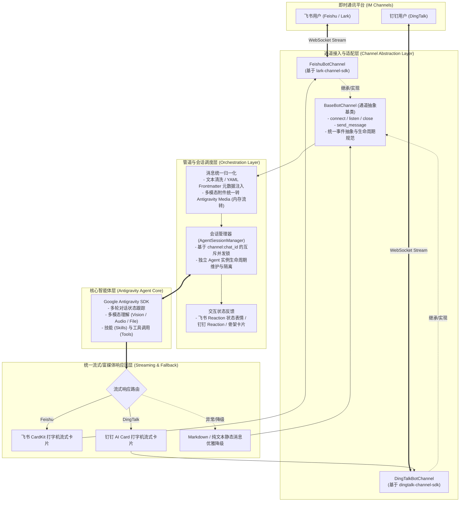

# AGENTS.md

这是一个基于 Google Antigravity SDK 与多渠道接入 SDK（`lark-channel-sdk`、`dingtalk-channel-sdk`）构建的通用企业级 IM 智能助手/机器人 CLI 工具。支持通过命令行模式进行主动消息投递，以及通过服务监听模式长连接监听消息并调用 Antigravity Agent 进行多轮对话与流式回复。

## 1. 高层级架构设计 (High-Level Architecture)

### 1.1 系统全景架构图



### 1.2 核心分层设计

1. **通道抽象层 (Channel Layer)**
   - **统一接口规范**：通过 `BaseBotChannel` 定义标准的生命周期管理（`start_listening()`、`send_message()`、`close()`）与消息分发事件（`on_message()`）。
   - **双向长连接传输**：飞书与钉钉均基于官方/开源的 WebSocket Stream 协议，无需公网 IP、无须暴露 Webhook 端口，在内网服务器或本地环境均可实现双向双工通信。
   - **平台适配器**：
     - `FeishuBotChannel`：封装 `lark-channel-sdk`，管理飞书 WebSocket 客户端、CardKit 打字机流式卡片、表情状态章及富文本资源拉取。
     - `DingTalkBotChannel`：封装 `dingtalk-channel-sdk`，管理钉钉 Stream Client、AI 卡片打字机流式更新与降级机制。

2. **消息归一化与多模态适配层 (Normalization & Media Pipeline)**
   - **统一消息元数据协议**：将飞书与钉钉的异构消息格式归一化提取，并封装为 YAML Frontmatter 格式前置注入 Agent，便于 Agent 清晰感知渠道平台、会话类型（单聊/群聊）、发送者与消息上下文：
     ```yaml
     ---
     channel: feishu | dingtalk
     chat_id: "..."
     sender_id: "..."
     message_id: "..."
     create_time: "..."
     chat_type: "p2p" | "group"
     ---
     ```
   - **多模态附件流式转置**：自动将接收到的图片、音频、通用附件拉取至内存缓冲区，利用 `create_media_from_bytes` 工具统一转化为 Antigravity 原生 Media 对象，全程无磁盘临时文件残留，安全高效。

3. **会话编排与并发控制层 (Session & Concurrency Layer)**
   - **细粒度会话锁**：按照 `f"{channel}:{chat_id}"` 维护并发锁（`asyncio.Lock`），确保相同会话内的并发消息串行消费，彻底杜绝多消息并发造成的上下文污染与模型响应交错。
   - **即时思考反馈 (Typing Indicator)**：在 Agent 推理与工具执行过程中，统一触发对端平台的状态感知反馈（如飞书状态表情章 `typing_reaction`，钉钉卡片 loading/思考态），显著提升用户等待体验。

4. **智能体核心层 (Antigravity Agent Runtime)**
   - 基于 `google-antigravity` SDK，按会话动态管理 Agent 实例（支持指定工作目录、模型名称与系统提示词）。
   - 暴露 `AsyncGenerator` 流式输出，直接打通底层各平台的打字机卡片渲染链路。

5. **统一应用与 CLI 入口层 (CLI & Runners)**
   - **命令行模式 (CLI Mode)**：支持按指定渠道（`--channel feishu/dingtalk`）向目标会话主动投递文本、Markdown、多图及混合附件。
   - **服务监听网关模式 (Service Mode)**：支持启动特定单一通道，或同时启动飞书和钉钉双通道长连接，作为跨平台统一 AI 机器人网关。

---

## 2. 核心功能

### 命令行模式 (CLI Mode)
- 用户可通过命令行指定平台与目标会话，发送文本、Markdown、图片以及本地附件文件，支持单文件与多文件混合发送。

### 服务监听模式 (Service Mode)
- 启动长连接监听飞书/钉钉事件；收到消息后拉取多模态数据并激活 Antigravity Agent；
- 优先通过各平台的打字机卡片（Feishu CardKit / DingTalk AI Card）流式打字回显，在卡片不支持或限流时自动平滑降级为静态 Markdown / 纯文本。

---

## 3. 开发工具与环境规范

- **Python 版本**：`>= 3.14`
- **包管理工具**：严格使用 `uv` 进行依赖管理与环境执行。
- **自动化测试**：`uv run pytest` 执行单元测试与集成测试。
- **代码规范检查**：`uv run ruff check` 与 `uv run ruff format`。

---

## 4. 编码规范

- **导入风格**：包内部模块间引用（`src/channel_bot_cli_antigravity` 内部各模块及 `__init__.py`）统一使用**显式相对导入**（如 `from .config import Config`、`from .channels.base import BaseBotChannel`、`from .utils import create_media_from_bytes`），严禁在包内使用绝对导入自身包名。
- **适配器解耦规范**：
  - 各具体渠道的 SDK 依赖（`lark_channel`、`dingtalk_channel_sdk`）严格隔离在 `channels/` 对应的实现中，不得侵入 `agent.py` 或公共业务层。
  - 通道适配器对外暴露统一且一致的异步 API 签名。
- **健壮性与优雅降级**：所有外部网络 I/O、资源下载、流式卡片更新均须包裹完善的错误处理与保底降级逻辑，保证服务常驻不中断。

---

## 5. 目录结构

```text
channel-bot-cli-antigravity/
├── pyproject.toml                         # 项目元数据与依赖配置
├── README.md                              # 项目使用说明
├── AGENTS.md                              # Agent 与高层级架构设计规范
├── src/
│   └── channel_bot_cli_antigravity/       # 核心源码包
│       ├── __init__.py                    # 包导出与版本定义
│       ├── cli.py                         # CLI 命令行入口与服务启动调度
│       ├── config.py                      # 统一多渠道配置模型 (Feishu / DingTalk / AGY)
│       ├── agent.py                       # Antigravity Agent 会话管理器与多轮交互
│       ├── utils.py                       # 多模态媒体转换与公共辅助工具
│       └── channels/                      # 通道抽象与各平台适配层
│           ├── __init__.py                # 通道工厂与对外导出
│           ├── base.py                    # 通用通道基类 (BaseBotChannel) 与统一消息类型
│           ├── feishu.py                  # 飞书通道适配器 (基于 lark-channel-sdk)
│           └── dingtalk.py                # 钉钉通道适配器 (基于 dingtalk-channel-sdk)
├── tests/                                 # 测试目录
│   └── test_*.py                          # 单元测试用例
└── skills/                                # 配套 Skill 文档与能力扩展
    └── channel-bot-cli-antigravity/
```